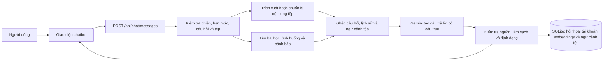

# Chatbot CyberAware AI: chức năng và cách hoạt động

Tài liệu này mô tả chatbot theo mã nguồn hiện tại: giao diện, API, truy xuất dữ liệu, xử lý ảnh/tài liệu, lưu hội thoại, hạn mức và kiểm thử. Chatbot dùng Google Gemini ở phía máy chủ; trình duyệt không nhận khóa API.

## Tổng quan

Chatbot là một luồng hỏi đáp có truy xuất dữ liệu dự án trước khi tạo câu trả lời. Có thể xem đây là một dạng RAG đơn giản: hệ thống tìm nội dung liên quan trong dữ liệu CyberAware, đưa các đoạn tìm được vào ngữ cảnh của Gemini, sau đó kiểm tra và định dạng câu trả lời trước khi gửi về giao diện.

Mã chính nằm ở [backend/chat/chat.ts](../../backend/chat/chat.ts), [backend/chat/chatKnowledge.ts](../../backend/chat/chatKnowledge.ts), [backend/chat/chatSemantic.ts](../../backend/chat/chatSemantic.ts) và [backend/chat/attachments.ts](../../backend/chat/attachments.ts). Giao diện nằm ở [src/components/chat/Chatbot.tsx](../../src/components/chat/Chatbot.tsx).

## Các tệp trong `backend/chat/`

| Tệp | Trách nhiệm |
| --- | --- |
| [`chat.ts`](../../backend/chat/chat.ts) | **Điều phối chính của API chatbot.** Tạo/cập nhật các bảng SQLite, dọn dữ liệu hết hạn, đọc cấu hình và hạn mức; nhận diện khách/tài khoản; kiểm tra request, quota, lịch sử và quyền sở hữu hội thoại; gọi các phần xử lý tệp và truy xuất nguồn; đếm token, gọi Gemini, kiểm tra đầu ra rồi lưu hội thoại/ngữ cảnh. Các route công khai như `/capabilities`, `/messages` và các route lịch sử hội thoại cũng được khai báo tại đây. |
| [`chatKnowledge.ts`](../../backend/chat/chatKnowledge.ts) | **Chuẩn bị dữ liệu tri thức và xếp hạng nguồn.** Đọc tình huống, bài học đã phát hành và cảnh báo đã duyệt; tách nội dung thành các đoạn; tính điểm từ khóa, cosine similarity và điểm kết hợp; cung cấp tìm từ khóa dự phòng khi embeddings không khả dụng. Tệp này không gọi Gemini. |
| [`chatSemantic.ts`](../../backend/chat/chatSemantic.ts) | **Tạo và sử dụng embeddings cho truy xuất.** Gọi `gemini-embedding-001` cho đoạn tài liệu và câu hỏi, lưu vector theo fingerprint trong `chat_knowledge_embeddings`, nạp vector đã lưu và gọi hàm xếp hạng trong `chatKnowledge.ts`. Nếu bước embedding lỗi, nó trả về kết quả từ tìm từ khóa. |
| [`attachments.ts`](../../backend/chat/attachments.ts) | **Kiểm tra và đọc tệp đính kèm.** Kiểm tra định dạng/chữ ký/kích thước; chuẩn hóa ảnh; trích xuất PDF, DOCX, XLSX; giữ vị trí trang, đoạn hoặc ô; chọn phần tài liệu liên quan khi văn bản quá dài. Tệp này không gọi Gemini và không lưu tệp vào DB; `chat.ts` quyết định nội dung nào được đưa vào prompt hoặc giữ làm ngữ cảnh. |

### Các tệp hỗ trợ nằm ngoài `backend/chat/`

- [`backend/routes/admin/chatSettings.ts`](../../backend/routes/admin/chatSettings.ts): khai báo route quản trị đọc/cập nhật cấu hình chatbot và ghi sự kiện audit.
- [`backend/admin.ts`](../../backend/admin.ts): đăng ký router cấu hình chatbot vào nhóm API quản trị.
- [`shared/chatAnswer.ts`](../../shared/chatAnswer.ts): chuẩn hóa xuống dòng, thay ID nguồn bằng tên nguồn, lọc nguồn đưa về client và định dạng câu trả lời.
- [`backend/ai/modelFallback.ts`](../../backend/ai/modelFallback.ts): chọn model chat dự phòng khi model chính gặp lỗi có thể thử lại.

### Luồng gọi giữa các tệp

1. `chat.ts` nhận request. Nếu có tệp, nó gọi `attachments.ts` để xác thực, trích xuất và chọn nội dung.
2. `chat.ts` gọi `chatSemantic.ts` để truy vấn tri thức. `chatSemantic.ts` lấy dữ liệu/đoạn và xếp hạng qua `chatKnowledge.ts`.
3. `chat.ts` ghép câu hỏi, lịch sử, nguồn và ngữ cảnh tệp thành prompt rồi gọi Gemini.
4. Khi nhận đầu ra, `chat.ts` dùng `shared/chatAnswer.ts` để làm sạch nội dung và nguồn, sau đó lưu kết quả cho tài khoản hoặc trả về khách.

## Nguồn dữ liệu chatbot truy xuất

Trước khi gọi Gemini, máy chủ tạo danh sách nguồn từ các dữ liệu sau:

- **Tình huống:** các mục trong danh mục `scenario`, gồm tóm tắt và khuyến nghị phòng tránh.
- **Bài học:** nội dung bài học của khóa học đã phát hành; không đưa bài kiểm tra/quiz vào nguồn. Hướng dẫn ứng phó sự cố của khóa học cũng được đưa vào.
- **Cảnh báo:** bản ghi `threat_intel` có trạng thái `reviewed` và URL nguồn HTTPS.

Nguồn được gửi cho Gemini gồm tiêu đề, loại và phần nội dung liên quan. ID nội bộ không được gửi ra giao diện như nguồn công khai. Câu trả lời chỉ hiển thị các nguồn mà Gemini chọn qua `sourceTitles` và máy chủ đối chiếu với danh sách nguồn thực sự đã truy xuất.

## Tìm kiếm và tạo câu trả lời

1. Máy chủ chia nội dung nguồn thành các đoạn có kích thước tối đa khoảng 1.200 ký tự.
2. Với mỗi đoạn, Gemini Embeddings dùng mô hình `gemini-embedding-001` tạo vector 768 chiều. Vector được lưu trong bảng `chat_knowledge_embeddings` của SQLite cùng dấu vân tay nội dung; đoạn không đổi dùng lại vector đã lưu.
3. Câu hỏi được nhúng theo tác vụ truy vấn. Hệ thống so sánh cosine similarity với các đoạn đã lưu, kết hợp điểm ngữ nghĩa (72%) và điểm khớp từ khóa (28%), sau đó chọn tối đa ba nguồn.
4. Nếu embeddings không dùng được, chatbot chuyển về tìm kiếm từ khóa hiện có thay vì dừng trả lời.
5. Máy chủ ghép câu hỏi, tối đa sáu tin nhắn lịch sử, nguồn truy xuất và tệp hiện tại/tệp đã giữ trong hội thoại. Gemini được yêu cầu trả JSON gồm `answer` và `sourceTitles`.
6. Máy chủ chỉ giữ nguồn được chọn từ nguồn hợp lệ, thay ID trích dẫn bằng tên nguồn, loại ID nội bộ còn sót và định dạng câu trả lời trước khi trả về.

Embedding cache được tạo lại khi nội dung nguồn thay đổi. Lần lập chỉ mục đầu tiên hoặc sau khi nội dung đổi sẽ gửi các đoạn mới lên Gemini Embeddings. Số token embedding truy vấn được ghi nhận bằng ước lượng ký tự/token trong hạn mức của chatbot; embedding tài liệu ban đầu không nằm trong con số token của lượt chat này nhưng vẫn có thể phát sinh mức sử dụng API phía Google.

Đây là RAG dùng SQLite và phép so sánh cosine trong ứng dụng, chưa dùng dịch vụ vector database riêng. Embeddings chỉ áp dụng cho tri thức nội bộ nói trên; phần chọn đoạn trong tệp người dùng hiện dùng xếp hạng từ khóa, không tạo embeddings riêng cho từng tệp.

## Ảnh và tài liệu đính kèm

Mỗi lượt chỉ nhận một tệp. Máy chủ kiểm tra phần mở rộng, MIME type, chữ ký tệp và kích thước trước khi xử lý.

| Loại | Cách xử lý | Giới hạn hiện tại |
| --- | --- | --- |
| PNG, JPG/JPEG, WEBP | Đọc và chuẩn hóa ảnh, xoay theo metadata, thu nhỏ tối đa 1.800 px, chuyển sang JPEG để gửi Gemini; tạo ảnh xem trước nhỏ hơn cho giao diện. | Tối đa 2 MiB; cần bật `imagesEnabled`. |
| PDF | Trích xuất văn bản theo trang. PDF scan, không có chữ hoặc phần lớn trang thiếu chữ có thể được gửi trực tiếp cho Gemini để đọc hình ảnh/trang. | Tệp tối đa 8 MiB, không quá 60 trang. |
| DOCX | Trích xuất văn bản thô theo đoạn; không gửi toàn bộ bố cục hoặc hình nhúng như một tài liệu trực quan. | Tệp tối đa 8 MiB; văn bản trích xuất tối đa 160.000 ký tự. |
| XLSX | Đọc giá trị ô, ghi tên trang tính và tọa độ dòng/ô để có thể dẫn vị trí. | Tệp tối đa 8 MiB; tối đa 8 trang tính, 800 dòng và 40 cột mỗi trang tính. |

Định dạng khác như DOC, XLS, CSV, PPTX, ZIP và tài liệu có mật khẩu chưa được hỗ trợ. Tài liệu dài được chia đoạn và chọn theo câu hỏi, tối đa khoảng 28.000 ký tự đưa vào bước xử lý tệp của lượt hiện tại. Nội dung tệp không được bảo đảm đã che mật khẩu, OTP hoặc dữ liệu nhạy cảm; người dùng nên che thông tin riêng trước khi tải lên.

Với tài liệu văn bản dài hơn giới hạn đưa vào prompt, hệ thống chấm đoạn theo từ/cụm từ câu hỏi và lấy các đoạn phù hợp cùng phần lân cận. Vì bước này chưa dùng semantic search, nếu câu hỏi diễn đạt khác hẳn từ ngữ trong một tài liệu dài thì đoạn cần thiết có thể không được chọn. Tài liệu ngắn trong giới hạn được đưa nguyên phần văn bản trích xuất vào ngữ cảnh.

## Ngữ cảnh tiếp theo và lịch sử

- **Tài khoản đăng nhập:** hội thoại và cặp tin nhắn người dùng/trợ lý được lưu trong SQLite. Máy chủ đưa tối đa sáu tin nhắn gần nhất vào ngữ cảnh. Hội thoại được dọn sau 30 ngày; người dùng có thể xóa hội thoại, việc này cũng xóa ngữ cảnh tệp gắn với nó.
- **Khách:** nội dung hội thoại không được lưu trong lịch sử máy chủ. Giao diện gửi tối đa sáu tin nhắn lịch sử trong phiên trình duyệt để Gemini hiểu câu hỏi tiếp theo.
- **Tệp đã gửi:** văn bản trích xuất được giữ riêng để hỗ trợ câu hỏi tiếp theo. Ảnh đã xử lý hoặc PDF gửi trực tiếp chỉ được giữ thêm nếu dữ liệu không quá 2 MiB. Máy chủ chọn tối đa ba tệp gần nhất cho mỗi hội thoại, giới hạn sáu tệp cho mỗi tài khoản/định danh khách. Ngữ cảnh của tài khoản hết hạn tối đa sau 30 ngày; khách sau 24 giờ. Ngữ cảnh tệp của khách được lưu tạm ở máy chủ dù hội thoại của khách không được lưu ở đó.

Ở câu tiếp theo, hệ thống dùng câu hỏi hiện tại và các câu hỏi gần đây để chọn phần liên quan từ tối đa ba tệp gần nhất. Nếu tài liệu dài, không phải toàn bộ văn bản được gửi lại mỗi lượt. Gemini được chỉ dẫn nêu giới hạn khi phần nội dung đưa vào chưa đủ căn cứ.

### Các bảng SQLite liên quan

| Bảng | Nội dung |
| --- | --- |
| `chat_settings` | Cấu hình chatbot và các hạn mức do quản trị viên chỉnh. |
| `chat_conversations` | Hội thoại của tài khoản: chủ sở hữu, tiêu đề và thời điểm cập nhật. |
| `chat_messages` | Tin nhắn người dùng/trợ lý, nguồn, thời gian và metadata tệp; ảnh xem trước có thể được lưu trong metadata hội thoại tài khoản. |
| `chat_usage` | Bộ đếm theo actor và ngày: lượt yêu cầu, token được tính, lượt ảnh và trạng thái xử lý. |
| `chat_attachment_context` | Văn bản trích xuất cùng dữ liệu ảnh/PDF trực tiếp đủ điều kiện để dùng ở câu hỏi tiếp theo; có thời điểm hết hạn. |
| `chat_knowledge_embeddings` | Embedding của từng đoạn tri thức, fingerprint để phát hiện nội dung đổi và thời điểm cập nhật. |

Tin nhắn hội thoại khách không được ghi vào `chat_messages`; bảng ngữ cảnh tệp vẫn có thể giữ tạm nội dung tệp của khách theo TTL nêu trên.

## Bảo vệ dữ liệu và giới hạn phạm vi

- Hướng dẫn hệ thống yêu cầu trả lời bằng tiếng Việt về phòng chống lừa đảo, coi tin nhắn, lịch sử, ảnh, tài liệu và trích đoạn là dữ liệu không tin cậy, bỏ qua chỉ dẫn nhúng trong đó, không suy diễn vượt quá nội dung và không tiết lộ ID nội bộ.
- Văn bản câu hỏi/lịch sử có regex che một số mẫu OTP, mật khẩu và token phổ biến. Đây là che mẫu cơ bản, không phát hiện mọi bí mật; nội dung tệp không được lọc bằng cơ chế này.
- **Chưa có bộ lọc chủ đề chạy trước bước truy xuất.** System instruction định hướng câu trả lời nhưng không phải chặn kỹ thuật tuyệt đối đối với mọi câu hỏi ngoài phạm vi. Vì vậy, câu hỏi vẫn có thể đi qua bước embedding và sử dụng quota Gemini.
- Hệ thống không tự chấm điểm nguy cơ cho nội dung trò chuyện, mở URL, xác minh chủ tài khoản hoặc hứa hẹn thu hồi tiền.

## Hạn mức và cấu hình

Giá trị mặc định trong mã nguồn:

| Đối tượng | Lượt chat/ngày | Token nội bộ/ngày | Lượt gửi ảnh/ngày |
| --- | ---: | ---: | ---: |
| Khách | 10 | 40.000 | 3 |
| Tài khoản | 40 | 160.000 | 10 |

Các mức trên có thể được quản trị viên thay đổi bằng API cấu hình chatbot. Ngoài hạn mức theo ngày, API có giới hạn 30 yêu cầu/phút theo IP; bộ giữ chỗ SQLite còn giới hạn tần suất ngắn hạn theo định danh và không cho một định danh có nhiều lượt đang chờ cùng lúc. Một câu hỏi bị giới hạn ở 2.000 ký tự và tối đa 800 token theo phép đếm của model. Ngữ cảnh đầu vào có giới hạn riêng theo loại lượt; máy chủ gọi `countTokens` trước khi tạo câu trả lời và có thể bỏ bớt lịch sử, nguồn hoặc đoạn tệp để vừa giới hạn.

Cấu hình máy chủ:

- `GEMINI_API_KEY`: bắt buộc, chỉ đặt ở máy chủ.
- `GEMINI_CHAT_MODEL`: model trả lời; mặc định `gemini-3.1-flash-lite`.
- `GET /api/chat/capabilities`: trả trạng thái chatbot, khả năng gửi ảnh và hạn mức còn lại.
- `GET/PATCH /api/admin/chat/settings`: quản trị xem/cập nhật các mức chat và bật/tắt tính năng.

Mẫu biến môi trường được đặt trong [`.env.example`](../../.env.example); không đặt khóa Gemini trong biến `VITE_*` hoặc mã giao diện.

Các API hội thoại tài khoản gồm `GET /api/chat/conversations`, `GET /api/chat/conversations/:id` và `DELETE /api/chat/conversations/:id`. Lượt hỏi dùng `POST /api/chat/messages`, nhận JSON hoặc `multipart/form-data`.

## Giao diện

Khi gửi, tin người dùng và vùng trả lời đang chờ xuất hiện ngay trên màn hình; ô nhập được làm trống để người dùng gửi ý tiếp theo. Các tin nhắn được xử lý tuần tự trong hàng đợi, tối đa năm tin đang xử lý/chờ. Ảnh người dùng gửi được hiện trong tin nhắn; tên tệp tài liệu cũng được hiển thị. Câu trả lời được tách đoạn, tiêu đề, danh sách đánh số và gạch đầu dòng để dễ đọc.

## Kiểm thử và đánh giá

- `npm run lint`: kiểm tra TypeScript.
- `npm test`: bộ test API và chatbot; gồm kiểm tra truy xuất hybrid/fallback, PDF, ngữ cảnh hỏi tiếp từ Excel, chỉ dẫn gây nhiễu trong tài liệu và xóa ngữ cảnh theo hội thoại.
- [Bộ câu hỏi truy xuất](../../tests/fixtures/chat-retrieval-evaluation.json) chứa tám trường hợp tiếng Việt gắn với nguồn kỳ vọng trong nội dung mẫu của dự án.
- `npm run evaluate:chat:retrieval`: gọi Gemini Embeddings thật trên SQLite tạm, đo recall@3 và MRR. Lệnh này cần `GEMINI_API_KEY` và sử dụng quota API; nó không thuộc `npm test`.

Các test mô phỏng Gemini; chỉ lệnh đánh giá riêng mới kiểm tra trực tiếp embeddings của nhà cung cấp. Bộ đánh giá hiện đo chất lượng xếp hạng nguồn, chưa đo độ chính xác đầu cuối của mọi câu trả lời do Gemini tạo ra.
